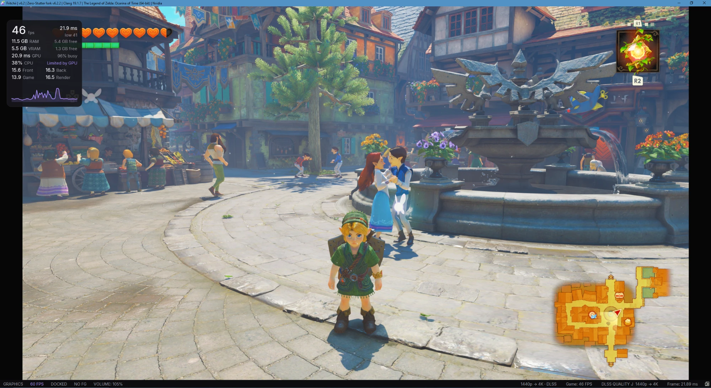
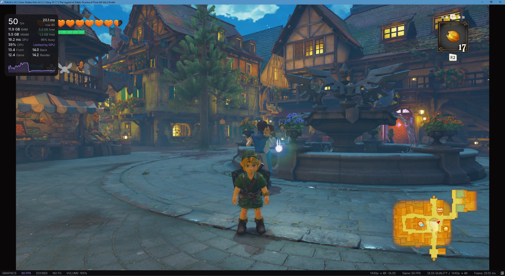
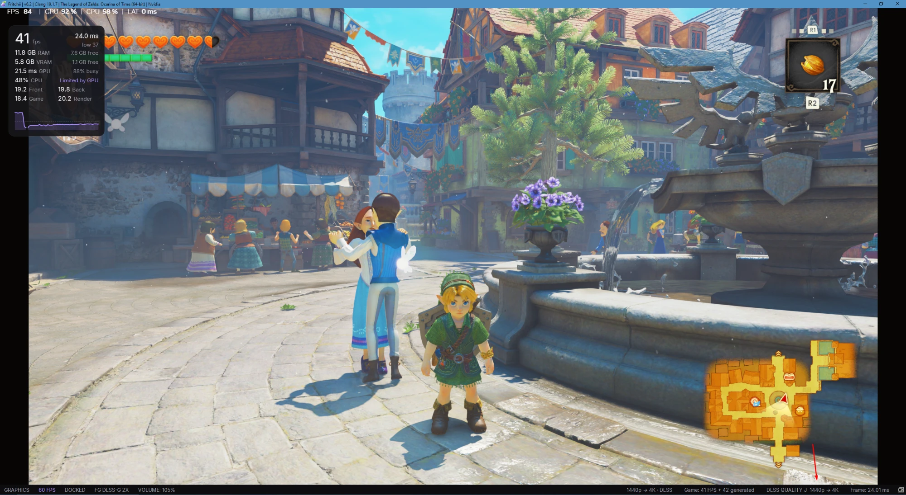
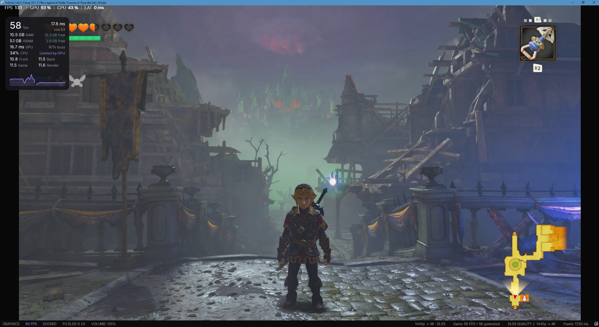
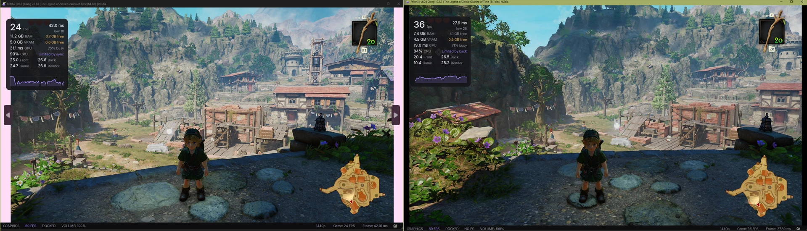
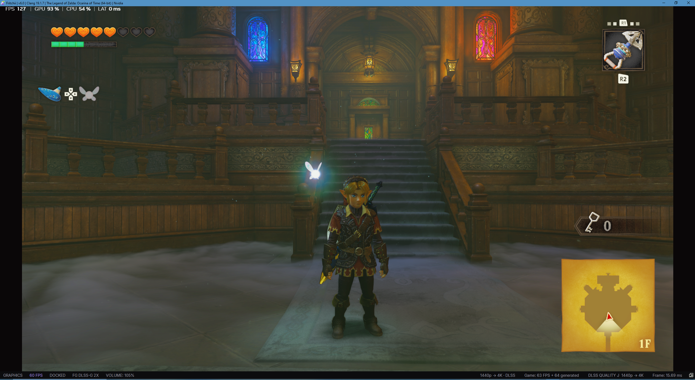

# Fritchii Zero-Stutter Custom Build (v6.2.2)
### *The Legend of Zelda: Ocarina of Time (Nintendo Switch 2 Remake) on PC*

[](https://github.com/giangero1/Fritchii-ZeroStutter/releases)
[](https://www.gnu.org/licenses/gpl-3.0)

**Fritchii Zero-Stutter** is an unofficial, modified fork of Fritchii aimed at the stutters, compile freezes and VRAM slowdowns in *The Legend of Zelda: Ocarina of Time Remake* on PC. It was tuned on an **AMD Ryzen 7 5800X3D + NVIDIA RTX 3070 8 GB** running **1440p → 4K DLSS + DLSS-G 2X frame generation**.

The **v6.2 Zero-Stutter update** moves the engine onto **upstream Fritchii v6.2** and fixes the three problems players reported on v6.x:
1. A **hitch about once a second** in 3D gameplay (with reactive flushing on), without losing foliage animation.
2. The **white light / overexposure flash** when turning the camera.
3. **10–20 seconds of very low FPS after entering a new area** on 8 GB cards. It now recovers in **1–2 s** on most loads, even with a browser and a Twitch stream open next to the game.

> ⚠️ **Test release.** It was measured on one PC (RTX 3070 8 GB + 5800X3D). If anything looks or runs worse for you, every fix below has its own off-switch. **Provided as is, with no support.**

---

## 🆕 New in v6.2.2: 4K on 8 GB cards stays smooth in the market, faster loads on 10 GB+ cards

**1. Coming back to the Castle Town market at 4K on an 8 GB card.** On an **RTX 3070 8 GB** at **1440p → 4K DLSS**, the daytime market ran fine on the first visit. But after going outside and back, or after walking around it for a few minutes, the FPS slowly dropped to **5–8 and never came back**. The cause: the market at 4K needs nearly all of an 8 GB card. Other apps (browser, Discord, the desktop) use ~1 GB more. Once the card was full, the NVIDIA driver moved part of the game's VRAM into normal RAM, and every frame got slow. Three things kept the emulator from freeing memory in time:
- **Leftovers from the previous area:** half-empty memory blocks, a pool of old render images, and textures the clean-up thought were still recent.
- **The VRAM budget didn't count other apps.** The emulator aimed at ~7 GB when only ~6 GB was really free.
- **The texture cache protected everything used in the last ~10–15 s** (to avoid reloading the same textures), so while you walked around the market almost nothing could be freed.

What v6.2.2 does on cards under 9 GB (bigger cards are not affected):
- **Area clean (`FRITCHII_AREA_CLEAN`, on by default):** for 8 s after an area starts loading, the old area's leftovers go: the image pool is emptied, textures not drawn in the last 15 frames are deleted (they load again if needed), half-empty blocks are packed together and given back.
- **The budget counts other apps' VRAM**, and the emulator aims **1.5 GB** under it (was 1 GB). `FRITCHII_VRAM_BUDGET_MODE` and `FRITCHII_VRAM_HEADROOM_MIB` still override this.
- **When VRAM is over that target, the texture cache only protects the last ~60 frames** instead of 600, and its limit can go lower, so it can free textures you just walked away from.

Same route on the RTX 3070 (market → outside → market, walking around, talking to NPCs): average **66 → 73 FPS**, 1% low **9 → 24 FPS**, frames over 100 ms **178 → 20**. Going back into the market three times in a row and talking to many NPCs stayed smooth.

The trade-off: textures get deleted and loaded again more often, so you may see a little pop-in, or a short dip when something big appears (like the close-up when you talk to an NPC). 4K on 8 GB is still right at the limit: closing GPU-heavy apps (or turning off their hardware acceleration) gives the game more room. To get the old behaviour: `FRITCHII_AREA_CLEAN=0`, `FRITCHII_VRAM_BUDGET_MODE=1`, `FRITCHII_VRAM_HEADROOM_MIB=1024`.

**2. Area loads on bigger cards.** v6.2's ASTC scratch cap (`FRITCHII_ASTC_SCRATCH_CAP_MIB`) held textures back during area loads, so 8 GB cards don't overflow VRAM. It did that on every card, even with lots of VRAM free. On a tester's **RTX 4070 12 GB** (1.2 of 11 GB used) each area load took **~28 s**; with the cap off, **~4–7 s**. Now, on cards of 9 GB and up, the cap only holds textures back when VRAM is past 7/8 of the budget. Cards under 9 GB always keep it, as in v6.2.1.

**3. Crash when closing Fritchii (and when restarting a game) fixed.** v6.2.1's GPU timers (`FRITCHII_GPU_ZONES`) kept Vulkan objects alive after the game stopped. Closing Fritchii could then crash, and starting a game again in the same window used the old ones. They're now cleaned up when the game stops, and the timers are **off by default** (`FRITCHII_GPU_ZONES=1` turns them on).

**4. OBS / Medal Vulkan game capture is off, also without the launcher.** A tester's game froze while loading shaders with OBS's game-capture hook inside Fritchii, and pressing Stop then crashed the NVIDIA driver. The launcher already turned these capture layers off; now `fritchii.exe` does it too when started directly. To stream, use OBS's **window** or **display** capture, or set `DISABLE_VULKAN_OBS_CAPTURE=0` before starting Fritchii.

**5. The window title shows the fork version** ("Zero-Stutter fork v6.2.2"), next to the Fritchii version it's based on.





*RTX 3070 8 GB + Ryzen 7 5800X3D, Castle Town market by day (46 FPS) and by night (50 FPS), 1440p → 4K DLSS, **frame generation off**.*

> **Known issue: switching to fullscreen while a game is running can crash.** Changing the window mode during play (for example from borderless to exclusive fullscreen) can crash in the NVIDIA driver. Choose your mode **before** starting a game: Emulation → Configure → Graphics → **Fullscreen Mode**. **Borderless Windowed** is recommended; it performs about the same on Windows 10/11.

---

## 🆕 New in v6.2.1: VRAM defragmentation (daytime Castle Town market at 4K)

The **daytime Castle Town market** (child Link, after the Temple of Time) is the heaviest scene in the game for VRAM. On an 8 GB card at **1440p → 4K DLSS + frame generation** it filled VRAM, FPS kept dropping even after walking away, and after a few minutes the **NVIDIA driver crashed**.

The cause: textures share 32 MB memory blocks, and a block only goes back to Windows when it's completely empty. In the market, **~500 MB of VRAM sat unused in half-empty blocks**, which was about how far over the limit it went.

**The fix (`FRITCHII_VRAM_DEFRAG`, on by default):** when VRAM is near the limit and at least 256 MB is wasted in holes, the emulator moves textures that are not in use right now into the gaps of fuller blocks (at most 64 MB a second, copied on the GPU), and hands the emptied blocks back.



**Measured on an RTX 3070 8 GB + Ryzen 7 5800X3D, daytime market, 1440p → 4K DLSS + frame generation 2X:**

| | v6.2 | v6.2.1 |
| :--- | :--- | :--- |
| Crash after a few minutes in the market | Yes (NVIDIA driver) | **No crashes in testing** |
| Wasted VRAM in half-empty blocks | ~500 MB | **~50–130 MB** (up to 1.4 GB given back in a minute) |
| VRAM free | 0 GB, over the limit | **~1.1 GB** |
| FPS in the market (screenshot above) | dropping, then crash | **84 on screen (41 game + 42 generated)**, GPU 21.5 ms |

*Honest note:* in one longer session (time travel back and forth before the market) the same scene still ran at ~19 game FPS without crashing, so results can vary with how much VRAM has built up.

**Also new:** `FRITCHII_GPU_ZONES` (off since v6.2.2, `=1` turns it on) writes a line to the log every 10 s with how much GPU time DLSS, frame generation and texture decoding take. In the market DLSS takes ~4 ms a frame and frame generation under 1 ms.

---

## 🔥 New in v6.2 Zero-Stutter

### 1. The once-a-second hitch is gone, and foliage still moves (`EDEN_NX2_STALE_READS`)
* **The problem:** every frame the game reads wind/foliage data the GPU wrote. With reactive flushing on, each read stopped the game until the busy GPU thread delivered it: 45–64 ms hitches about once a second. Turning reactive flushing off removed the hitch but froze grass and trees.
* **The fix:** areas the game reads every frame are served from the previous frame's copy (at most one frame old, which you can't see), and a fresh copy is fetched in the background without waiting. The first read of any area still waits as before. Reactive flushing stays **on**, so foliage animates.

### 2. Timer thread no longer competes with the game
* The HostTiming thread's busy-wait is capped at 20% and kept off the GPU threads (`FRITCHII_HOSTTIMING_SPIN_BUDGET`, `FRITCHII_HOSTTIMING_OFF_GPU`, `FRITCHII_HOSTTIMING_PRIORITY`).

### 3. White light / overexposure fix carried to v6.2
* v6.2 still dropped the occlusion sample count once the counter passed its bank limit (white flashes when turning the camera). This build carries the count into a new query instead (port of zortos293/Lichii `dfde522b40`).

### 4. Fast recovery after area loads on 8 GB cards
An area load in OoT (Castle Town → Hyrule Field) used to push VRAM from ~5 GB to **9.9 GB on a 7.1 GB budget** within one second. Windows then moved memory to system RAM, and the game ran at **4–7 FPS for 10–20 seconds**. Here is what each fix does:

| Fix | What it does | Off-switch |
| :--- | :--- | :--- |
| **ASTC decode cap** | Each new ASTC texture decodes into a temporary copy 4–8× its final size. A load decoded ~800 at once (+5 GB). Now at most **512 MB** of decodes are in flight; the rest decode a frame later. | `FRITCHII_ASTC_SCRATCH_CAP_MIB=0` |
| **Load-surge eviction** | When a load starts, up to 1 GB of the **old area's** idle, unchanged textures are dropped at once, so the new area reuses that space instead of overflowing. | `FRITCHII_VRAM_DRAIN=0` |
| **Block drain** | Textures share 32–64 MB memory blocks, and a block only goes back to Windows when it is completely empty. Mostly-empty blocks whose remaining textures can be reloaded are now emptied whole. Wasted VRAM: **~1 GB → ~0.35 GB**. | `FRITCHII_VRAM_DRAIN=0` |
| **Time-based cleanup** | Leftover upload buffers and empty blocks were freed per *frame* (64 or 60 frames), which takes 10–16 s at 4 FPS. They are now also freed every 250 ms near the budget. | `FRITCHII_STAGING_PRESSURE_PURGE=0` |
| **1 GB safety margin** | On 8 GB cards (small card profile) the texture cache keeps ~1 GB free instead of ~450 MB, so a load has room to land. | `FRITCHII_VRAM_HEADROOM_MIB=<MiB>` |
| **Depth buffer packing** | Small per-character depth buffers no longer pin 64 MB blocks (depth pool waste 250–400 MB → 30–90 MB). | `FRITCHII_DEPTH_POOL_FIT=0` |
| **VRAM defragmentation (v6.2.1)** | Near the limit, textures not in use are moved out of half-empty memory blocks so the blocks go back to Windows (~500 MB of holes → ~50–130 MB in the market). | `FRITCHII_VRAM_DEFRAG=0` |
| **Load guard + memory priority** | Faster budget checks during a load, and render targets are marked "keep in VRAM" for the driver. | `FRITCHII_VRAM_LOAD_GUARD=0`, `FRITCHII_VRAM_PRIORITY=0` |

**Measured on an RTX 3070 8 GB, 1440p → 4K DLSS Quality + DLSS-G 2X, Brave + Twitch open:**

| Area load | Before | v6.2 Zero-Stutter |
| :--- | :--- | :--- |
| Peak VRAM during a load | 9.9 GB (budget 7.1) | ~7.0 GB |
| Low FPS after a load | 10–20 s at 4–7 FPS | **1–2 s** on 7 of 8 loads, ~6 s worst |



* **RTX 3070 8 GB + Ryzen 7 5800X3D, Castle Town ruins (adult), 1440p → 4K DLSS Quality J + DLSS-G 2X:**
  * **131 FPS** on screen: **58 game FPS** (1% low 53) + 56 generated, 17.6 ms frame time, 0 ms added latency.
  * GPU 93–97% busy, CPU 34–43%, **limited by GPU**: the CPU/sync is no longer the bottleneck.
  * 5.1 GB VRAM used with **2.0 GB free**, 10.5 GB system RAM.

**Tester reports: 6 GB cards.**



* **RTX 2060 6 GB + i5-8500, Kakariko Village, 1440p** (screenshot above, left is upstream v6.2, right is Zero-Stutter):

  | | Upstream v6.2 | v6.2 Zero-Stutter |
  | :--- | :--- | :--- |
  | FPS (1% low) | 24 (10) | **36 (25)** |
  | Frame time | 42.0 ms | **27.9 ms** |
  | VRAM used / free | 5.0 GB / **0.0 GB free** | 4.5 GB / **0.6 GB free** |
  | System RAM used | 11.2 GB | **7.4 GB** |
  | Bottleneck | Limited by sync | Limited by back |

* **Another 6 GB card:** after one restart, the visual bugs were gone. FPS was 27–35 in Castle Town Market and above 40 in other areas. They reported much more stable frame times, a lot less stuttering, and no more audio stutter.

The VRAM changes were made for 8 GB cards, but they help on 6 GB too. Upstream runs the 6 GB card out of VRAM (0.0 GB free). The extra ~4 GB of system RAM it uses is most likely Windows paging that memory out.

### 5. Preloading all shaders is now off (`EDEN_NX2_PRELOAD_ALL_PIPELINES=0`)
* Building all ~19k cached shaders at boot kept them all in driver memory (~0.45 MB each), which by itself overflowed 8 GB cards in new areas. Now the **~7.5k shaders you actually use** are built at boot ("Preparing shaders 7,477"). The rest build on demand from the driver cache in a few ms each. **You should still download the shader pack below.** It's what makes those on-demand builds instant.

---

## 🏛️ The Core Zero-Stutter Pillars (carried over from v5.x / v6.0)

### 1. Compute Shader `DontInline` Directive (Combat Freeze Fix)
* Upstream SPIR-V compilation inlines large compute global memory helpers, causing NVIDIA driver compile spikes of **up to 7.6 seconds** when Link hits grass, smashes pots or strikes enemies. `inline_mode = 2` (compute-only `DontInline`, graphics stays inlined) drops that to **<1 ms**. Override: `EDEN_NX2_SPIRV_INLINE_GLOBALS=0/1/2/3`.

### 2. `GuessMissing` Disk Pipeline Cache Fallback
* `env.SetGuessMissing(&guess)` in `vk_pipeline_cache.cpp` lets pipelines with unrecorded constant buffer descriptors load from the disk cache instead of being discarded.

### 3. Full Multi-Engine Frame Generation (since v5.9)
* **RTX 30-series DLSS-G** through OpenDLSSG + FakeNVAPI (`version.dll`, `opendlssg.ini`, `fakenvapi.dll`, `nvapi64.dll`, `nvngx_dlssg.dll`) with the Streamline error-32 bypass, plus native Vulkan FSR 3.1 optical flow and LSFG. Right-click **`FG`** on the status bar to switch.



### 4. Portable Launcher (`Play-Fritchii-6.2.2-ZeroStutter.cmd`)
* Starts `fritchii.exe` at high priority, turns the Graphics Pipeline Library (GPL) off, and sets the Zero-Stutter environment flags.

---

## 💾 Pre-Warmed Shader Cache (`fork-v54`)

Still recommended for v6.2. The used list builds at boot, and everything else builds instantly from this cache on demand:
- 🔗 **Download:** [`fritchii-fork-v54-shader-cache.zip`](https://github.com/giangero1/Fritchii-ZeroStutter/releases/download/v6.2-zerostutter/fritchii-fork-v54-shader-cache.zip) (450 MB, on the v6.2 release page)

*The old Google Drive / Gofile links held `fork-v52`/`fork-v53` files from v5.9 and have been removed. v6.x needs `fork-v54`.*

The zip already has the right folders: extract it straight into your emulator folder (next to `fritchii.exe`), or put `vulkan-frizti.fork-v54.bin` and `vulkan_used-frizti.fork-v54.bin` into:
```text
fritchii-v6.2.2-zerostutter-win64/
├── Play-Fritchii-6.2.2-ZeroStutter.cmd
├── nx2_switches.txt
├── fritchii.exe
├── lichii.exe
└── user/
    └── cache/
        └── shader/
            └── 0400486024dec000/    <--- EXTRACT SHADER FILES HERE
                ├── vulkan-frizti.fork-v54.bin
                └── vulkan_used-frizti.fork-v54.bin
```
*The first boot after a new driver or a new emulator build runs "Preparing shaders" once. This can take 10–20 minutes for a full pack. Later boots are fast.*

### Want the full ~120k precompiled shaders? Get Frizti's recipe from the official Fritchii

The shader pack above holds the ~19k-shader cache. The **~120k precompiled shaders** (116,351 graphics + 4,085 compute in the log) come from Frizti's **recipe file**, `recipes\OoT v131072 (cache v54).nx2recipe`. It comes only with the **official Fritchii download from Frizti**. Frizti's recipe license doesn't allow forks to include it, so **it is not in this fork's zip**, and without it you won't see the 120k.

To get them:
1. Download the official **Fritchii v6.2** from Frizti.
2. Copy its whole `recipes` folder (the `.nx2recipe` file and `RECIPE-LICENSE.txt`) next to `fritchii.exe` in your fork folder.
3. Start the game. The first boot runs "Preparing shaders" for your GPU (this can take 10–20 minutes). Later boots are fast, and the log shows "116351 graphics and 4085 compute pipelines".

*Frizti's license says the recipe is for use inside Fritchii and needs his permission for other builds. Read `RECIPE-LICENSE.txt` and ask Frizti on Discord if you're unsure. Shader precompile recipe by Frizti (Fritchii).*

---

## ⚙️ CPU Core & Thread Tuning (For 6-Core & 4-Core Users)

If your CPU has fewer than 8 cores, open `Play-Fritchii-6.2.2-ZeroStutter.cmd` (or **Tools → Switches** / `nx2_switches.txt`) and adjust `EDEN_NX2_WARM_THREADS`:

| CPU Cores / Threads | Example Processors | Recommended `WARM_THREADS` |
| :--- | :--- | :---: |
| **8 Cores / 16 Threads** | AMD Ryzen 7 5800X3D / Intel Core i7-13700 | **`6`** *(Default)* |
| **6 Cores / 12 Threads** | AMD Ryzen 5 5600X / Intel Core i5-12400 | **`4`** |
| **4 Cores / 8 Threads** | Intel Core i3-12100 / AMD Ryzen 3 3300X | **`2`** |

---

## 🚀 Quick Start Guide

1. Download **`fritchii-v6.2.2-zerostutter-win64.zip`** from [Releases](https://github.com/giangero1/Fritchii-ZeroStutter/releases/latest).
2. Extract it into a clean folder (e.g. `D:\Games\Fritchii-6.2.2-ZeroStutter`). Coming from v6.2.x or v6.0? You can copy your old `user` folder over (saves, config, shader cache), or just replace `fritchii.exe` in your v6.2.x folder.
3. *(Recommended)* Put the two `fork-v54` shader files into `user\cache\shader\0400486024dec000\`.
   For the full ~120k precompiled shaders, also copy the `recipes` folder from the official Fritchii (see [the recipe section](#want-the-full-120k-precompiled-shaders-get-friztis-recipe-from-the-official-fritchii)).
4. Run **`Play-Fritchii-6.2.2-ZeroStutter.cmd`**.
5. Right-click **`FG`** on the status bar (or **Emulation → Configure → Graphics**) to pick **DLSS-G**, **Optical Flow** or **LSFG**.

**Something wrong?** Add the matching off-switch from the table above to `nx2_switches.txt` (one per line, e.g. `EDEN_NX2_STALE_READS=0`), and restart.

---

## 📜 Credits & License Attribution
* Built as an **unofficial modified fork** based on upstream Fritchii v6.2 (GNU GPLv3) and Lichii/Eden/yuzu contributors. It is not affiliated with Frizti's original release and is not presented as one.
* White light fix ported from **zortos293/Lichii** (`dfde522b40`).
* **Shader precompile system by Frizti (Fritchii)** *(per GPLv3 Section 7 attribution notice; proprietary `*.nx2recipe` files are not redistributed in this fork's packages)*.

---

## 📦 Previous Versions (Preserved Backups)
- **Fritchii v6.2.1 Zero-Stutter:** [v6.2.1 Release](https://github.com/giangero1/Fritchii-ZeroStutter/releases/tag/v6.2.1-zerostutter) and the [`release/v6.2.1-zerostutter`](https://github.com/giangero1/Fritchii-ZeroStutter/tree/release/v6.2.1-zerostutter) branch.
- **Fritchii v6.2 Zero-Stutter:** [v6.2 Release](https://github.com/giangero1/Fritchii-ZeroStutter/releases/tag/v6.2-zerostutter) and the [`release/v6.2-zerostutter`](https://github.com/giangero1/Fritchii-ZeroStutter/tree/release/v6.2-zerostutter) branch.
- **Fritchii v6.0 Zero-Stutter (4K 127 FPS):** [v6.0 Release](https://github.com/giangero1/Fritchii-ZeroStutter/releases/tag/v6.0-zerostutter) and the [`release/v6.0-zerostutter`](https://github.com/giangero1/Fritchii-ZeroStutter/tree/release/v6.0-zerostutter) branch.
- **Fritchii v5.9.0 Zero-Stutter:** [v5.9.0 Release](https://github.com/giangero1/Fritchii-ZeroStutter/releases/tag/v5.9.0-zerostutter) and the [`release/v5.9.0-zerostutter`](https://github.com/giangero1/Fritchii-ZeroStutter/tree/release/v5.9.0-zerostutter) branch.
- **Fritchii v5.8.4 Zero-Stutter:** [v5.8.4 Release](https://github.com/giangero1/Fritchii-ZeroStutter/releases/tag/v5.8.4-zerostutter-r1).
- **Fritchii v5.3 Zero-Stutter:** [v5.3 Release](https://github.com/giangero1/Fritchii-ZeroStutter/releases/tag/v5.3-zerostutter-r1) and the [`backup/v5.3`](https://github.com/giangero1/Fritchii-ZeroStutter/tree/backup/v5.3) branch.
