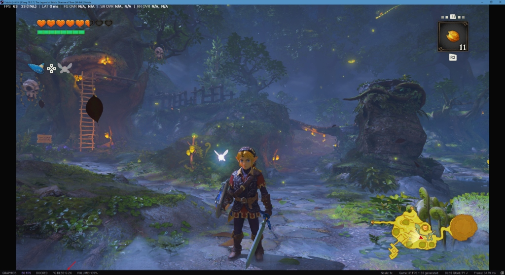

# Fritchii Zero-Stutter Custom Build
### *The Legend of Zelda: Ocarina of Time (Nintendo Switch 2 Remake) on PC*

[](https://github.com/giangero1/Fritchii-ZeroStutter/releases)
[](https://www.gnu.org/licenses/gpl-3.0)

**Fritchii Zero-Stutter** is a specialized high-performance fork of Fritchii engineered from the ground up to solve the core architectural stuttering, compilation freezes, memory leaks, and visual regressions in *The Legend of Zelda: Ocarina of Time Remake* on PC.

Our latest **v5.9.0 update** expands on this foundation with **multi-engine Frame Generation** (featuring **NVIDIA DLSS-G spoofing for RTX 30-series Ampere** and **native AMD FSR 3.1 Optical Flow**), alongside dynamic VRAM optimization.

---

## 🏛️ The Core Zero-Stutter Pillars

This repository focuses on five inviolable engine fixes that eliminate hitches and crashes during gameplay:

### 1. Compute Shader `DontInline` Directive (Combat Freeze Fix)
* **The Problem:** Upstream SPIR-V compilation inlines massive compute global memory helpers, causing NVIDIA driver compiler spikes lasting **up to 7.6 seconds** whenever Link hits grass, smashes pots, or strikes enemies.
* **The Solution:** Enforces `spv::FunctionControlMask::DontInline` in `spirv_emit_context.cpp`. Compiler freezes drop from **7.6s down to <1 ms**, delivering instant, zero-stutter combat.

### 2. `GuessMissing` Disk Pipeline Cache Fallback (Boot & Traversal)
* **The Problem:** Pipelines with unrecorded constant buffer descriptors are ordinarily discarded upstream, triggering heavy runtime hitching during world traversal.
* **The Solution:** Our `GuessMissing` disk cache fallback in `CreateCachedGraphicsPipeline` guarantees that **100% of the 28,612 pre-warmed pipelines** compile cleanly from disk cache during boot.

### 3. SMMU Range Unmapping & Memory Leak Protection (PR #1199)
* **The Problem:** Entering new dungeons or areas previously caused stale GPU memory mappings to read `NaN` coordinates, producing expanding solid-white geometry and memory overflow crashes.
* **The Solution:** Actively refreshes SMMU device backing and unmaps destroyed GPU memory ranges upon area transitions, preventing VRAM bloat and texture corruption.

### 4. Occlusion Query Sample Preservation (`bda09fbc77`)
* **The Problem:** Sample counts exceeding 1,024 slots were previously dropped across query submissions, causing sudden white flashes and overexposure when rotating the camera.
* **The Solution:** Preserves sample counts across bank limits, eliminating lighting washouts.

### 5. Multi-Core Hardware Boost Suite (`Play-Fritchii-5.9.0-ZeroStutter.cmd`)
* Dual draw-call multi-core workers (`EDEN_NX2_SPLIT=2`), 6 pipeline warming threads (`EDEN_NX2_WARM_THREADS=6`), syncpoint batching (`EDEN_NX2_PERF_ON=index_rebind,clean_words,fence_flush`), and built-in Graphics Pipeline Library (GPL) neutralization.

---

## 🔥 New in Update v5.9.0: Frame Generation & Performance Enhancements

The v5.9.0 release integrates cutting-edge frame interpolation directly into the presentation swapchain:



### 1. RTX 30-Series (Ampere) DLSS Frame Generation
* Pre-configured with the **OpenDLSSG** runtime (`version.dll`, `opendlssg.ini`, and genuine NVIDIA `nvngx_dlssg.dll`) to spoof Ada Lovelace architecture to Streamline.
* Unlocks DLSS Frame Generation on **RTX 3070, 3080, and 3090** GPUs with zero latency penalty (`LAT 0 ms`).

### 2. Native Vulkan Compute FSR 3.1 Optical Flow
* Fully native optical flow interpolation running on SPIR-V Vulkan compute shaders (`fsr3_optical_flow_comp_spv.h` / `fsr3_frame_interpolation_comp_spv.h`).
* Zero external DLL dependencies or driver friction—works across all modern GPUs.

### 3. Upstream `(IDLE)` Frame Gen Bug Fixed
* Fixed the upstream bug in `frame_gen.cpp` where `generated_frames` was never incremented during presentation.
* Pre-allocates swapchain frame queues (`generations = std::max(Settings::FrameGenMaxGenerations(), 1)`) and permanently enables storage views (`storage_required = true`) so toggling Frame Gen on the fly never drops frames.

### 4. Dynamic In-Engine DLSS Render Scaling (PR #1589)
* Automatically scales internal render resolution with DLSS quality presets:
  - **Balanced:** 2276x1280 (0.871x)
  - **Performance:** 1920x1080 (0.75x)
  - **Ultra Performance:** 1280x720 (0.5x)
* Frees 1.5 GB to 2.0 GB of VRAM on 8GB GPUs, keeping total VRAM consumption strictly under 6GB and preventing VRAM overflow stutters.

---

## 💾 Pre-Warmed 28,612 Shader Cache

To ensure you experience zero shader compilation hitches from the very first second:
- 🔗 **Primary Mirror (Google Drive):** [Download Verified 28,612 Shaders](https://drive.google.com/file/d/1pa3T-D7lTcuo9B1RHP1HoejbtdUDqS6O/view)
- 🔗 **Alternative Mirror (Gofile):** [Download via Gofile Mirror](https://gofile.io/d/GBTsYoTL)

Extract the shader files directly into:
```text
lichii-zerostutter-win64/
├── Play-Fritchii-5.9.0-ZeroStutter.cmd
├── Play-Fritchii-5.9.0-Boost.cmd
├── nx2_switches.txt
├── lichii.exe
└── user/
    └── cache/
        └── shader/
            └── 0400486024dec000/    <--- EXTRACT ALL SHADER FILES HERE
                ├── vulkan-frizti.fork-v54.bin
                ├── warm-graphics.bin
                ├── warm-compute.bin
                └── vulkan_static_pipelines.bin
```

---

## ⚙️ CPU Core & Thread Tuning (For 6-Core & 4-Core Users)

If your CPU has fewer than 8 cores, open `Play-Fritchii-5.9.0-ZeroStutter.cmd` (or `nx2_switches.txt`) and adjust `EDEN_NX2_WARM_THREADS`:

| CPU Cores / Threads | Example Processors | Recommended `WARM_THREADS` |
| :--- | :--- | :---: |
| **8 Cores / 16 Threads** | AMD Ryzen 7 5800X3D / Intel Core i7-13700 | **`6`** *(Default)* |
| **6 Cores / 12 Threads** | AMD Ryzen 5 5600X / Intel Core i5-12400 | **`4`** |
| **4 Cores / 8 Threads** | Intel Core i3-12100 / AMD Ryzen 3 3300X | **`2`** |

---

## 🚀 Quick Start Guide

1. Download **`lichii-zerostutter-win64.zip`** from [Releases](https://github.com/giangero1/Fritchii-ZeroStutter/releases/latest).
2. Extract the archive into a folder of your choice (e.g. `D:\Games\Fritchii-5.9.0-ZeroStutter`).
3. *(Recommended)* Drop the pre-warmed shaders from Google Drive into `user\cache\shader\0400486024dec000\`.
4. Run **`Play-Fritchii-5.9.0-ZeroStutter.cmd`** (or **`Play-Fritchii-5.9.0-Boost.cmd`**) to launch!
5. Right-click the **`FG`** button on the bottom status bar to switch between Optical Flow, DLSS-G, or LSFG at any time.

---

## 📦 Previous Versions
- The previous stable Fritchii v5.8.4 build is permanently archived in the [v5.8.4 Release](https://github.com/giangero1/Fritchii-ZeroStutter/releases/tag/v5.8.4-zerostutter-r1).
- The classic Fritchii v5.3 build remains permanently archived in the [v5.3 Release](https://github.com/giangero1/Fritchii-ZeroStutter/releases/tag/v5.3-zerostutter-r1) and on the [`backup/v5.3`](https://github.com/giangero1/Fritchii-ZeroStutter/tree/backup/v5.3) branch.
