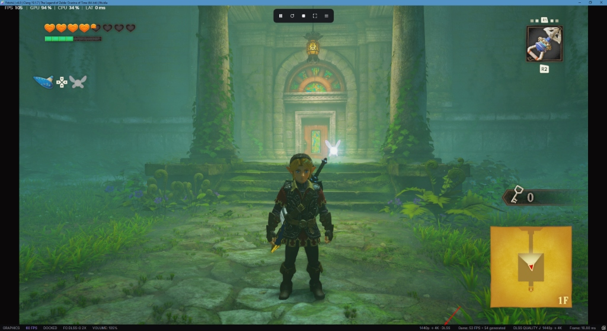

# Fritchii v6.0 Zero-Stutter Custom Build
### *The Legend of Zelda: Ocarina of Time (Nintendo Switch 2 Remake) on PC*

**Fritchii Zero-Stutter** is an unofficial, modified high-performance fork of Fritchii engineered to eliminate shader/compute compilation freezes, disk cache stalls, and lighting regressions in *The Legend of Zelda: Ocarina of Time Remake* on PC — while bringing **full 120 FPS Multi-Engine Frame Generation** (including **NVIDIA Streamline DLSS-G + RTX 30-Series OpenDLSSG**) onto **Fritchii v6.0**.

* **Verified Performance (Temple Interior — Full 4K DLSS Quality J + DLSS-G 2X):** **105–107 FPS** (**53 Base Game FPS + 54 Generated Frames**), **94% GPU**, **34% CPU**, **0 ms latency overhead** (`1440p → 4K · DLSS`) on **RTX 3070 8GB + Ryzen 7 5800X3D**. Lowering output to **1440p** or **DLSS Balanced** locks **60 base + 60 generated = 120 FPS**.

---

## 🔥 What's New in Fritchii v6.0 Zero-Stutter

Built directly on upstream **Fritchii v6.0** (`c36d853a96` — 1,191 commits over v5.8.4), combining every upstream v6.0 performance breakthrough with our complete Zero-Stutter & Frame Generation stack:

### Upstream Fritchii v6.0 Breakthroughs Preserved
* **3rd GPU Thread (`FRITCHII_ONEF_*`)**: Dedicated draw-recording thread removes the Castle Town Market CPU wall (60+ FPS locked in Market & Pot Room).
* **Shared 6-Core JIT Code Cache**: Saves ~1 GB RAM and cuts area-load stutter by ~25%.
* **8 GB VRAM Small-Card Mode (`FRITCHII_SMALL_CARD=2`)**: Keeps RTX 3070 8GB comfortably inside VRAM budget.
* **Built-In Dynamic DLSS Render Scaling (`#1589`)**, DLSS Jitter, Texture Sharpness, `Tools > Switches`, unified OoT settings, pot-room crash fix, and `fritchii.exe` + `lichii.exe` forwarder.

### Custom Zero-Stutter + 120 FPS FrameGen Engine Patches
1. **Compute Shader `DontInline` Default (`spirv_emit_context.cpp`)**:
   * Defaults `inline_mode` to **`2`** (compute-only `DontInline`, graphics stays inlined), eliminating 7.6-second NVIDIA Ampere compute shader compile freezes with zero graphics FPS loss.
   * Honors both `EDEN_NX2_COMPUTE_NOINLINE` and `EDEN_NX2_SPIRV_INLINE_GLOBALS` (`0` = all DontInline, `1` = all inlined, `2` = compute-only DontInline [default], `3` = v6 shared DontInline buffer search).
2. **`GuessMissing` Disk Pipeline Cache Fallback (`vk_pipeline_cache.cpp`)**:
   * Injects `env.SetGuessMissing(&guess)` inside `PipelineCache::CreateCachedGraphicsPipeline` so disk-cached pipelines with unrecorded buffer descriptors deserialize cleanly at boot instead of stalling mid-game.
3. **Occlusion Query Sample Carry Fix (`vk_query_cache.cpp`, `03534dc645`)**:
   * Carries occlusion sample counts across bank bounds instead of dropping them, eliminating Ocarina white-light flashes and overexposure.
4. **Full Multi-Engine Frame Generation Restored on v6.0**:
   * Re-enables the full Frame Generation subsystem removed in upstream `9f95262d0f` and exposes all FrameGen controls in Fritchii v6's Graphics UI (`FritchiiUi::HidesSetting`).
   * **Streamline DLSS Frame Generation (`#1508`) + RTX 30-Series OpenDLSSG**: Unlocks `FrameGenActive`, bypasses Streamline error 32 on RTX 3070/3080/3090 via OpenDLSSG + FakeNVAPI (`version.dll`, `opendlssg.ini`, `nvngx_dlssg.dll`), and fixes the `(IDLE)` ghost counter bug.
   * **Native Vulkan Compute Optical Flow & LSFG Fallbacks** also available via the bottom status bar **`FG`** button.

---

## ⚙️ CPU Core & Thread Tuning

Open `Play-Fritchii-6.0-ZeroStutter.cmd` (or `Tools > Switches` / `nx2_switches.txt`) to adjust `EDEN_NX2_WARM_THREADS`:

| CPU Cores / Threads | Example Processors | Recommended `WARM_THREADS` |
| :--- | :--- | :---: |
| **8 Cores / 16 Threads** | AMD Ryzen 7 5800X3D / Intel Core i7-13700 | **`6`** *(Default)* |
| **6 Cores / 12 Threads** | AMD Ryzen 5 5600X / Intel Core i5-12400 | **`4`** |
| **4 Cores / 8 Threads** | Intel Core i3-12100 / AMD Ryzen 3 3300X | **`2`** |

---

## 🚀 Quick Start Guide (v6.0)

1. Extract the release package to a clean folder (e.g., `D:\Games\Fritchii-6.0-ZeroStutter`).
2. Launch via **`Play-Fritchii-6.0-ZeroStutter.cmd`** (runs `fritchii.exe` with `GPL=false` and `EDEN_NX2_SPIRV_INLINE_GLOBALS=2`).
3. **First Launch Note (v6.0):** Because v6.0 updated shader translation and renamed the main executable to `fritchii.exe`, allow the one-time **"Preparing shaders"** step to complete on first boot. Subsequent launches start fast with zero stutters.
4. Right-click the **`FG`** button in the bottom status bar to toggle or switch between **DLSS-G**, **Optical Flow**, or **LSFG**.

---

## 📜 Credits & License Attribution
* Built as an **unofficial modified fork** based on upstream Fritchii v6.0 (GNU GPLv3) and Lichii/Eden/yuzu contributors — not affiliated with or presented as Frizti's original release.
* **Shader precompile system by Frizti (Fritchii)** *(per GPLv3 Section 7 attribution notice; proprietary `*.nx2recipe` files are not redistributed in this fork's packages)*.

---

## 📦 Previous Stable Backups (Preserved)
* **Fritchii v5.9.0 Zero-Stutter (Proven 120 FPS Backup):** Permanently preserved in the [v5.9.0 Release](https://github.com/giangero1/Fritchii-ZeroStutter/releases/tag/v5.9.0-zerostutter) and on the [`release/v5.9.0-zerostutter`](https://github.com/giangero1/Fritchii-ZeroStutter/tree/release/v5.9.0-zerostutter) branch.
* **Fritchii v5.8.4 Zero-Stutter:** Archived in the [v5.8.4 Release](https://github.com/giangero1/Fritchii-ZeroStutter/releases/tag/v5.8.4-zerostutter-r1).
* **Fritchii v5.3 Zero-Stutter:** Archived in the [v5.3 Release](https://github.com/giangero1/Fritchii-ZeroStutter/releases/tag/v5.3-zerostutter-r1) and on [`backup/v5.3`](https://github.com/giangero1/Fritchii-ZeroStutter/tree/backup/v5.3).
